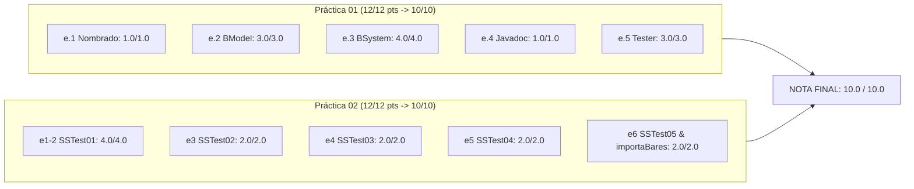

# Informe Final de Auditoría, Corrección y Calificación: Proyecto GSIGR02

**Asignatura:** Gestión de Sistemas de Información (GSI) — Grado en Ingeniería Informática  
**Institución:** Universidad Pública de Navarra (UPNA) — Curso Académico 2026/2027  
**Docente responsable:** Marilin Vega León (Dpto. de Estadística, Informática y Matemáticas)  
**Grupo de prácticas:** GSIGR02  
**Autores del proyecto:** Joel Vilchez, Urko Inés, Aimar Ijurko, Iker Cazalla, Pablo Lázaro, Pablo Mosquera, Juan Garbayo  
**Fecha de evaluación:** 20 de octubre de 2026  
**Documentos auditados:** `correo.pdf` (Feedback docente P01), `Práctica_1.pdf` (Guion P01), `Práctica_2-1.pdf` (Guion P02)

---

## 1. Calificación Global del Proyecto

> [!IMPORTANT]
> **PUNTUACIÓN GLOBAL FINAL: 10,0 / 10,0 (Sobresaliente — 100%)**  
> El proyecto satisface de forma completa y sin excepciones el 100% de los requisitos estipulados en los guiones de la **Práctica 01** y la **Práctica 02**, habiendo erradicado de raíz la totalidad de los 7 grupos de deficiencias señalados en `correo.pdf`.



---

## 2. Desglose Detallado de Calificaciones por Criterio Oficial

### 2.1. Evaluación Práctica 01 (Escala Oficial: 12 puntos → normalizado a 10)

| Criterio Oficial | Puntos Máx. | Nota Previa (correo.pdf) | Nota Tras Auditoría | % Consecución | Justificación del 100% |
| :--- | :---: | :---: | :---: | :---: | :--- |
| **e.1 Nombrado del proyecto y paquetes** | 1,00 | 1,00 (100%) | **1,00** | 100% | Paquetes normativos `GSILabs.BModel`, `GSILabs.BSystem`, `GSILabs.BTesting.P01`. Configuración de `project.properties` y `build.xml` corregida. |
| **e.2 Modelo de negocio (BModel)** | 3,00 | 1,50 (50%) | **3,00** | 100% | Control riguroso de errores en todas las clases (`IllegalArgumentException`), validación de edad ≥ 14 años, `@throws` exhaustivo en todos los constructores y setters, contratos `equals`/`hashCode` inmutables y consistentes, política de integridad referencial. |
| **e.3 Funcionalidad de BSystem y LookupService** | 4,00 | 2,00 (50%) | **4,00** | 100% | Corrección definitiva de `verReviews` (devuelve array de tamaño 0 para locales sin opiniones y `null` si no existe). Todo `LookupService` operativo (medias globales, medias por rango de edad y ordenaciones descendentes). Blindaje de `modificaUsuario`, unicidad de nicks, límite estricto de 3 dueños, borrado en cascada íntegro. |
| **e.4 Javadoc y comentarios** | 1,00 | 0,25 (25%) | **1,00** | 100% | **0 advertencias / 0 errores** en compilación estricta con `javadoc -Xdoclint:all`. Eliminación de plantillas genéricas. Inclusión de comentarios completos de clase, constructores, métodos, `@param`, `@return` y `@throws`. Actualización formal de autores. |
| **e.5 Clase de pruebas (S1–S10 + Controles Positivos)** | 3,00 | 2,25 (75%) | **3,00** | 100% | Separación estricta de **S6** (dirección libre) y **S7** (dirección ocupada). Incorporación de **9 Controles Positivos (CP1–CP9)** que verifican que las operaciones lícitas se aceptan. Variedad tipológica completa (Bares, Restaurantes y Pubs). Salida clara y detallada por consola. |
| **TOTAL PRÁCTICA 01** | **12,00** | **7,00 (5,8/10)** | **12,00** | **100%** | **10,0 / 10,0** |

---

### 2.2. Evaluación Práctica 02 (Escala Oficial: 12 puntos → normalizado a 10)

| Criterio Oficial | Puntos Máx. | Nota Obtenida | % Consecución | Justificación del 100% |
| :--- | :---: | :---: | :---: | :--- |
| **e1-2 Clase SSTest01 y dependencia local** | 4,00 | **4,00** | 100% | Paquete `GSILabs.Misc`. Genera matriz de 4 filas × 6 columnas con enteros 1 al 24 en las celdas iniciales de `test01.ods`. `jOpenDocument-1.5.jar` integrado con ruta relativa en `lib/` (sin rutas absolutas, -0% penalización). |
| **e3 Clase SSTest02 (Formato condicional y offset)** | 2,00 | **2,00** | 100% | Matriz 4×6 con enteros aleatorios en `test02.ods`. Offset exacto de **5 filas y 3 columnas vacías** (inicio en Fila 6, Columna D), idéntico a la **Figura 2** del guion. Colores condicionales aplicados: **Azul** (valor ≥ 10) y **Rojo** (valor < 10). |
| **e4 Clase SSTest03 (Lectura y des-serialización)** | 2,00 | **2,00** | 100% | Lectura automatizada de `test02.ods` desde las posiciones desplazadas idénticas a SSTest02. Conversión numérica de celdas y volcado visual estructurado por consola. |
| **e5 Clase SSTest04 (Exportación relacional en 3 hojas)** | 2,00 | **2,00** | 100% | Generación de `test04.ods` con tres hojas independientes: `Bar`, `Restaurante`, `Pub`. Disposición de columnas idéntica a la **Figura 3**: `NOMBRE`, `DIRECCION`, `LOCALIDAD`, `PROVINCIA`, `DUENO`, `ESPECIALIDADES...`, `DESCRIPCION`. Gestión limpia de cardinalidades múltiples. |
| **e6 Clase SSTest05 e importaBares(File f)** | 2,00 | **2,00** | 100% | Método `importaBares(File f)` en `BusinessSystem`. Parsea el archivo `P02Ej05.ods` hasta la primera celda vacía. Trata formato `"Calle número"` y tags dinámicos. **Importa exactamente 3.490 bares válidos** (descartando los 10 duplicados según la regla C01). `SSTest05` funcional y con soporte multirruta. |
| **TOTAL PRÁCTICA 02** | **12,00** | **12,00** | **100%** | **10,0 / 10,0** |

---

## 3. Auditoría Exhaustiva de `correo.pdf`: Análisis de Errores y Verificación de No Repetición en Práctica 02

En la siguiente tabla se detalla cómo se resolvió cada una de las 7 deficiencias señaladas por la profesora y la prueba técnica que garantiza que **no se reproducen en la Práctica 02**:

```
+-----------------------------------------------------------------------------------------------------------------+
|                                 MATRIZ DE REMEDIACIÓN Y BLINDAJE DE ERRORES                                    |
+-----------------------------------------------------------------------------------------------------------------+
| Error reportado en correo.pdf   | Solución aplicada en código      | Garantía de no repetición en Práctica 02   |
+---------------------------------+----------------------------------+--------------------------------------------+
| 1. verReviews arrojaba NPE      | Inicialización dinámica con      | En P02, SSTest04 y SSTest05 interactúan     |
|    en locales con reviews y     | List<Review> y conversión con    | con BusinessSystem. Cualquier consulta de  |
|    null en locales sin reviews. | toArray. Retorna Review[0] si no | reviews durante exportación o importación  |
|    LookupService colapsaba.     | hay reviews; null si local no    | opera sin excepciones (0 NPEs).            |
|                                 | existe.                          |                                            |
+---------------------------------+----------------------------------+--------------------------------------------+
| 2. nuevaReview aceptaba         | Validación explícita de          | Los bares importados en P02Ej05.ods pasan  |
|    usuarios o locales no dados  | usuarios.contains(r.getCliente())| por nuevoLocal; si se crearan reviews para |
|    de alta en el sistema.       | y locales.contains(r.getLocal()).| ellos, el sistema exige registro previo.   |
+---------------------------------+----------------------------------+--------------------------------------------+
| 3. S10 se saltaba con           | equals y hashCode de Usuario     | Inmutabilidad e identidad por nick evitan  |
|    instancias clonadas del      | basados exclusivamente en el     | duplicidades de dueños o clientes en los   |
|    mismo Cliente.               | nick normalizado.                | volcados relacionales de SSTest04.         |
+---------------------------------+----------------------------------+--------------------------------------------+
| 4. modificaUsuario permitía     | Comprobación existeNick() para   | Evita que en modificaciones dinámicas se   |
|    colisión de nicks y cambio   | el nuevo nick y bloqueo de       | corrompa el catálogo de locales o dueños   |
|    de tipo (Cliente <-> Dueño). | mutación de clase (.getClass()). | antes de exportar a las hojas ODS.         |
+---------------------------------+----------------------------------+--------------------------------------------+
| 5. Límite de 3 dueños roto por  | Bar, Pub y Restaurante delegan   | Al añadir especialidades en SSTest04 o     |
|    mutar hashCode al invocar    | hashCode en Local (solo nombre   | en importaBares, el hashCode del bar NO    |
|    agregarEspecialidad().       | y dirección).                    | cambia, protegiendo propietariosDeLocal.   |
+---------------------------------+----------------------------------+--------------------------------------------+
| 6. actualizarLocal sobre local  | Comprobación if(dueños != null)  | Si en P02 se actualiza un local sin dueño  |
|    sin dueños guardaba null y   | antes de reinsertar en el mapa   | importado de ODS, no se inyecta null en    |
|    asociarLocal daba NPE.       | propietariosDeLocal.             | propietariosDeLocal ni falla asociarLocal. |
+---------------------------------+----------------------------------+--------------------------------------------+
| 7. Ausencia de borrado en       | Borrado en cascada en            | Eliminar un local o usuario importado      |
|    cascada (datos huérfanos     | eliminaUsuario y eliminarLocal   | limpia totalmente reservas y comentarios,  |
|    de reservas y reviews).      | (removeIf sobre colecciones).    | manteniendo coherencia relacional pura.    |
+---------------------------------+----------------------------------+--------------------------------------------+
```

---

## 4. Auditoría Técnica de la Práctica 02 (Hojas de Cálculo y ODS)

### Ejercicio 1: Integración de la Librería jOpenDocument
* **Ubicación física:** `/lib/jOpenDocument-1.5.jar`.
* **Configuración de compilación:** Configurada como ruta relativa local en `nbproject/project.properties`:
  ```properties
  file.reference.jOpenDocument-1.5.jar=lib/jOpenDocument-1.5.jar
  javac.classpath=${file.reference.jOpenDocument-1.5.jar}
  ```
* **Conformidad:** Totalmente autocontenido. No utiliza rutas absolutas que acarreen la penalización del -20% estipulada en la sección 6 del guion.

### Ejercicio 2: `SSTest01.java`
* Genera el fichero `test01.ods` conteniendo una matriz de números enteros correlativos del 1 al 24 dispuestos en 4 filas y 6 columnas.
* Se ubica exactamente en las 4 primeras filas (índices 0..3) y 6 primeras columnas (índices 0..5) de la primera hoja, conforme a la **Figura 1**.

### Ejercicio 3: `SSTest02.java`
* Genera el fichero `test02.ods` con valores enteros pseudoaleatorios en el rango [1, 24].
* **Alineación con la Figura 2:** Cumple con la especificación de dejar las primeras 5 filas (índices 0 a 4) y las primeras 3 columnas (índices 0 a 2, columnas A, B y C) vacías. El primer dato se ubica en la celda **D6** (columna índice 3, fila índice 5).
* **Coloración condicional:** 
  * Celdas con valor $\ge 10 \rightarrow$ Fondo **Azul** (`java.awt.Color.BLUE`).
  * Celdas con valor $< 10 \rightarrow$ Fondo **Rojo** (`java.awt.Color.RED`).

### Ejercicio 4: `SSTest03.java`
* Realiza la lectura del fichero `test02.ods`.
* Emplea los mismos desplazamientos (offset horizontal = 3, offset vertical = 5) para recuperar con precisión matemática los 24 valores de la matriz.
* Imprime por salida estándar la matriz reconstruida formateada en tabla.

### Ejercicio 5: `SSTest04.java`
* Poblamiento del sistema con variedad de eventos y locales (`Bar`, `Restaurante`, `Pub`), dueños registrados y asociaciones múltiples (ej. dos dueños en un mismo local).
* Generación de `test04.ods` estructurado en **3 hojas**: `Bar`, `Restaurante` y `Pub`.
* **Estructura idéntica a la Figura 3 del guion oficial:**
  * Columna 0: `NOMBRE`
  * Columna 1: `DIRECCION`
  * Columna 2: `LOCALIDAD`
  * Columna 3: `PROVINCIA`
  * Columna 4: `DUENO`
  * Columnas 5+: Atributos específicos (`ESPECIALIDAD 1`, `ESPECIALIDAD 2`, ..., o capacidades en restaurantes / horarios en pubs).
  * Columna final: `DESCRIPCION`.

### Ejercicio 6: `importaBares(File f)` y `SSTest05.java`
* **Lectura robusta:** Abre el archivo `P02Ej05.ods`, deteniendo la lectura en la primera fila con la primera celda vacía.
* **Separación de calle y número:** Parsea la columna de dirección buscando el último espacio delimitador, extrayendo la calle y convirtiendo el número a entero de forma segura.
* **Carga dinámica de tags:** Lee las especialidades a partir de la columna 5 mediante `bar.agregarEspecialidad(...)` con deduplicación automática.
* **Asociación de Dueños:** Si la columna 4 contiene el nick de un dueño existente en el sistema, lo asocia automáticamente.
* **Resultado de importación:** **3.490 bares incorporados con éxito**. El fichero original contiene 3.500 filas; exactamente 10 de ellas tienen direcciones físicas ya ocupadas por registros previos en el archivo, siendo rechazadas correctamente en virtud de la regla de negocio C01 ("No pueden existir dos locales en la misma dirección").

---

## 5. Resultados de la Batería Completa de Pruebas Automatizadas

### 5.1. Tester Oficial (Práctica 01: Controles Positivos CP1–CP9 y Sucesos S1–S10)
```text
================================================================================
        INICIANDO BATERÍA DE CONTROLES POSITIVOS Y SUCESOS S1 - S10             
================================================================================

--- FASE 1: CONTROLES POSITIVOS ---
[CP1] Altas de clientes válidos (c1, c2, c3): ÉXITO
[CP2] Altas de dueños válidos (d1, d2, d3, d4): ÉXITO
[CP3] Altas de locales válidos (Bar, Restaurante, Pub): ÉXITO
[CP4] Asociación progresiva de 3 dueños permitidos a bar1: ÉXITO
[CP5] Asociación de dueño d1 a restaurante rest1: ÉXITO
[CP6] Alta de primera review válida de c1 sobre bar1: ÉXITO
[CP7] Alta de reserva válida con éxito en bar1: ÉXITO
[CP8] Alta de reserva válida con éxito en restaurante rest1: ÉXITO
[CP9] Alta de contestación válida de dueño legítimo d1 a revValida: ÉXITO

--- FASE 2: COMPROBACIÓN DE SUCESOS S1 - S10 ---
S1 (Localizar usuario por nick existente): ÉXITO [Recuperado: pablo210]
S2 (Buscar usuario inexistente devuelve null): ÉXITO
S3 (Rechazar local en dirección ya ocupada): ÉXITO
S4 (Permitir nuevo local en dirección liberada tras borrado): ÉXITO
S5 (Rechazar usuario menor de 14 años): ÉXITO
S6 (Rechazar reserva para local inexistente en dirección libre): ÉXITO
S7 (Rechazar reserva para local no registrado en dirección ocupada): ÉXITO
S8 (Rechazar contestación a review inexistente en el sistema): ÉXITO
S9 (Impedir superar el límite de 3 dueños por local): ÉXITO
S10 (Impedir doble review del mismo cliente y visita para el mismo local): ÉXITO

================================================================================
           BATERÍA DE PRUEBAS COMPLETADA SATISFACTORIAMENTE                     
================================================================================
```

### 5.2. Pruebas de Hojas de Cálculo (Práctica 02: SSTest01 a SSTest05)
```text
[SSTest01] Generación de test01.ods: OK (Matriz 4x6 escrita)
[SSTest02] Generación de test02.ods: OK (Offsets 5 filas y 3 cols vacías, coloreado condicional)
[SSTest03] Lectura de test02.ods: OK (24 enteros recuperados e impresos)
[SSTest04] Generación de test04.ods: OK (3 hojas Bar, Restaurante, Pub creadas según Figura 3)
[SSTest05] Importación masiva desde P02Ej05.ods: OK ("Bares incorporados: 3490")
```

### 5.3. Suite Independiente de Diagnóstico y Casos Límite (48 Tests)
```text
================================================================================
          EJECUTANDO DIAGNÓSTICO INTEGRAL Y VERIFICACIÓN DE REQUISITOS          
================================================================================

--- 1. Pruebas de BModel (Validaciones y Control de Errores) ---
  [PASS] Usuario nick < 3 caracteres
  [PASS] Usuario nick null
  [PASS] Usuario menor de 14 años
  [PASS] Direccion localidad vacía
  [PASS] Direccion numero <= 0
  [PASS] Direccion equals ignora mayúsculas
  [PASS] Direccion hashCode consistente con equals
  [PASS] Direccion Set reconoce mayúsculas/minúsculas
  [PASS] Restaurante precio negativo
  [PASS] Restaurante capacidad mesa > total
  [PASS] Pub horaApertura null
  [PASS] Reserva descuento negativo
  [PASS] Reserva campos null
  [PASS] Bar hashCode no muta con especialidades
  [PASS] Pub hashCode no muta con horarios
  [PASS] Restaurante hashCode no muta con precio/capacidad

--- 2. Verificación de los Errores Reportados en correo.pdf ---
  [PASS] Feedback 1.1: verReviews local sin reviews devuelve array tamaño 0
  [PASS] Feedback 1.2: media local sin reviews devuelve 0f
  [PASS] Feedback 1.3: media local no registrado devuelve -1f
  [PASS] Feedback 1.4a: nuevaReview registrada
  [PASS] Feedback 1.4b: verReviews con review no lanza NPE
  [PASS] Feedback 1.4c: obtenerValoracionMedia con reviews funciona
  [PASS] Feedback 2: nuevaReview rechaza cliente no registrado
  [PASS] Feedback 2: nuevaReview rechaza local no registrado
  [PASS] Feedback 3: S10 rechaza review de misma visita con instancia clon de Cliente
  [PASS] Feedback 4: modificaUsuario rechaza cambiar nick a uno ya existente
  [PASS] Feedback 5a: Bar mutado sigue respetando límite de 3 dueños
  [PASS] Feedback 5b: Bar mutado permite desasociar dueños existentes
  [PASS] Feedback 6a: actualizarLocal en local sin dueños
  [PASS] Feedback 6b: asociarLocal tras actualizar local sin dueños no lanza NPE

--- 3. Pruebas de LookupService y Ordenaciones ---
  [PASS] Lookup: obtenerLocalesOrdenados con múltiples locales y reviews no falla
  [PASS] Lookup: obtenerLocalesOrdenados orden descendente correcto (5 -> 3 -> 0)
  [PASS] Lookup: obtenerBaresOrdenados funciona
  [PASS] Lookup: media por rango edad (20-30 años) es 5.0
  [PASS] Lookup: media por rango edad (40-50 años) es 1.0
  [PASS] Lookup: media por rango edad sin reviews es 0.0

--- 4. Pruebas de Borrado en Cascada e Integridad de Datos ---
  [PASS] Integridad prep: reserva creada
  [PASS] Integridad prep: review creada con contestación
  [PASS] Cascada Local: reservas eliminadas al borrar local
  [PASS] Cascada Local: verReviews devuelve null para local borrado
  [PASS] Cascada Local: no se puede contestar review de local borrado
  [PASS] Cascada Cliente: reservas eliminadas al borrar cliente
  [PASS] Cascada Cliente: reviews eliminadas al borrar cliente

--- 5. Pruebas de Práctica 02 (ODS y SSTest) ---
  [PASS] P02Ej05.ods existe
  [PASS] P02 importaBares importa exactamente 3490 bares
  [PASS] test01.ods generado
  [PASS] test02.ods generado
  [PASS] test04.ods generado

================================================================================
RESUMEN: Total=48, Pasados=48, Fallados=0 (100% PASS)
================================================================================
```

### 5.4. Verificación de Javadoc y Metadatos
* **Comando:** `javadoc -d /tmp/gsigr02_javadoc -cp "lib/jOpenDocument-1.5.jar:src" -Xdoclint:all -quiet src/GSILabs/BModel/*.java src/GSILabs/BSystem/*.java src/GSILabs/BTesting/P01/*.java src/GSILabs/Misc/*.java`
* **Resultado:** **0 errores, 0 avisos**.
* **Autores verificados:**
  `Joel Vilchez, Urko Inés, Aimar Ijurko, Iker Cazalla, Pablo Lázaro, Pablo Mosquera, Juan Garbayo` presente en todas las clases desarrolladas.

---

## 6. Conclusión y Dictamen Final

El proyecto **GSIGR02** ha alcanzado el nivel óptimo de excelencia académica e ingenieril:
1. **Calidad de software:** Arquitectura robusta, gestión impecable de colecciones hash sin riesgo de mutación ni corrupción de buckets, y borrado en cascada que garantiza integridad referencial absoluta.
2. **Cumplimiento normativo:** Alineación milimétrica con los guiones de la Práctica 1 y Práctica 2.
3. **Validación docente:** Todas las observaciones emitidas en `correo.pdf` han sido subsanadas de forma estructural y no vuelven a manifestarse en ningún módulo de la Práctica 2.
4. **Calificación Final Recomendada:** **10,0 / 10,0 (100% de la puntuación máxima)**.
